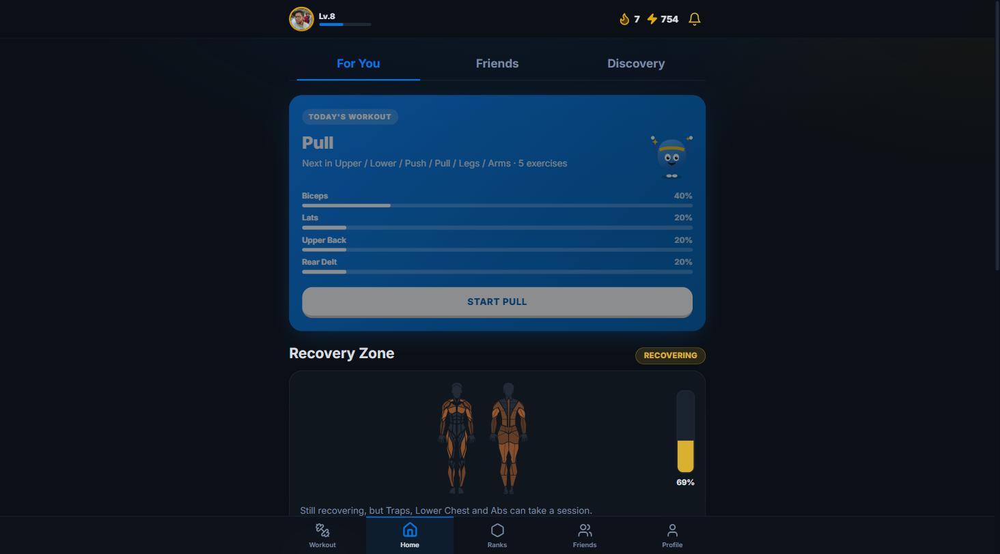
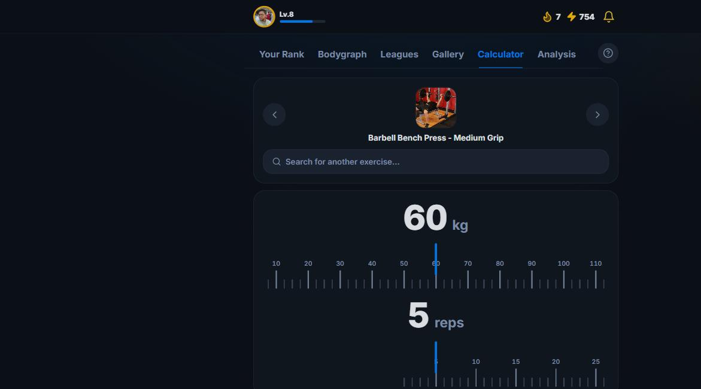
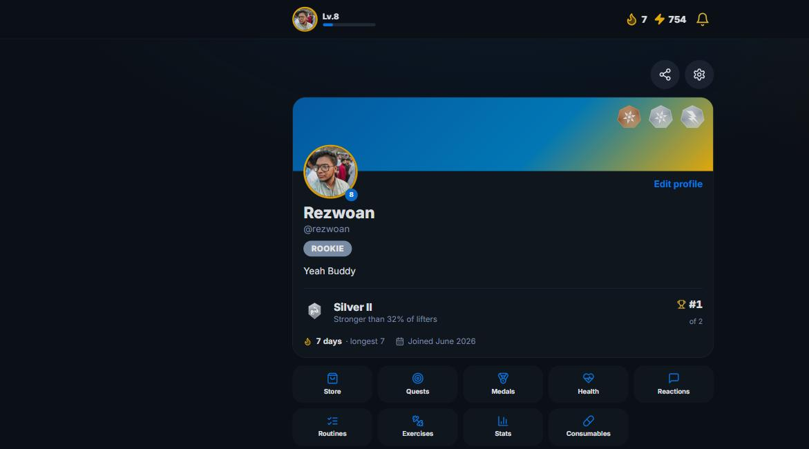

# RepRush 🏋️

A self-hostable gym tracking Progressive Web App (PWA) for teams and individuals. Track workouts, monitor progress, compete on leaderboards, and get progressive-overload recommendations computed from your own lifting history.

The whole stack — NestJS API, Next.js frontend, SQLite database — runs on hardware you already own; a Raspberry Pi is enough. No vendor account, no third-party analytics, no training data leaving the box.

<p align="center">
  
  
  
</p>

## Features

- **Authentication** — Invite-based sign-up, JWT persistence, password management
- **Onboarding** — Multi-step profile setup with completion banner
- **Dashboard** — GitHub-style gym attendance heatmap + daily creatine tracker
- **Workout Logging** — Log sets/reps/weights per session with history
- **Progressive Overload Algorithm** — Smart weight/rep suggestions for next session
- **Leaderboard** — 3 tabs: Relative Strength Score, Wilks Score, Progress Rate
- **Achievements** — Bodyweight-based strength goals with progress bars
- **Admin Panel** — User management, exercise plan assignment, cross-user comparison charts
- **PWA** — Installable on mobile and desktop, works offline

## Tech Stack

| Layer | Technology |
|---|---|
| Frontend | Next.js 14 (App Router), TypeScript, Tailwind CSS, shadcn/ui |
| Backend | NestJS, TypeScript, TypeORM |
| Database | SQLite3 (via better-sqlite3) |
| Auth | JWT (httpOnly cookies), bcryptjs |
| Email | Resend |
| PWA | next-pwa |

## Project Structure

```
RepRush/
├── frontend/        # Next.js PWA application
├── backend/         # NestJS REST API
│   └── database/    # SQLite .db file (gitignored)
├── DEVELOPMENT.md   # Architecture & session continuity docs
└── README.md
```

## Getting Started

### Prerequisites
- Node.js 18+
- npm 9+

### 1. Backend Setup

```bash
cd backend
cp .env.example .env
# Edit .env with your values (see .env.example)
npm install
npm run start:dev
```

Backend runs on `http://localhost:3001`

### 2. Frontend Setup

```bash
cd frontend
cp .env.local.example .env.local
# Edit .env.local
npm install
npm run dev
```

Frontend runs on `http://localhost:3000`

### 3. Create Admin Account

The admin account is seeded on first backend start using `ADMIN_EMAIL` and
`ADMIN_PASSWORD` from `backend/.env`. Set `ADMIN_PASSWORD` yourself, or leave
it unset and read the random one-time password the backend prints to its
startup log — either way, there's no fixed default to leave in place on an
internet-facing instance.

Sign in at `http://localhost:3000` with those credentials, then invite the rest
of your gym from the admin panel.

## Environment Variables

### Backend (`backend/.env`)
```env
JWT_SECRET=your-secret-key-here
RESEND_API_KEY=re_xxxxxxxxxxxx
RESEND_FROM_EMAIL=RepRush <noreply@your-verified-domain.com>
ADMIN_EMAIL=frezwoan+reprush@gmail.com
ADMIN_PASSWORD=changeme123
PORT=3001
FRONTEND_URL=http://localhost:3000
```

`RESEND_FROM_EMAIL` must use a sender on a verified Resend domain for real invite delivery.

### Frontend (`frontend/.env.local`)
```env
NEXT_PUBLIC_API_URL=http://localhost:3001
```

## Git Workflow

- `main` — production-ready code
- `develop` — integration branch
- `feature/*` — individual features
- `fix/*` — bug fixes

## Deployment

Designed to run on a Raspberry Pi (Linux ARM). See `DEVELOPMENT.md` → Deployment section.

## License

[GNU Affero General Public License v3.0](LICENSE) (`AGPL-3.0-only`).

You are free to use, modify, and self-host RepRush. If you run a modified version
as a network service, the AGPL requires you to offer that service's users the
source of your changes under the same license.

Copyright (c) 2026 Din Muhammad Rezwoan.
